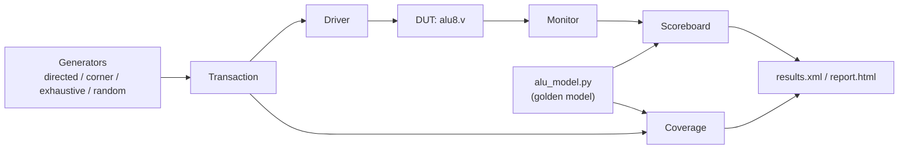

# 8-bit ALU Verification Framework (Verilog + Python)

[](https://github.com/mamoni19/alu8-verif/actions/workflows/ci.yml)

A self-checking verification environment for a combinational 8-bit ALU. The DUT is written in
Verilog, and checked against an independent Python golden model with **cocotb** and Icarus Verilog.
It includes functional coverage, seeded random testing, mutation testing and CI.

## Highlights
| | |
|---|---|
| DUT | 13 operations (ADD, SUB, AND, OR, XOR, NAND, NOT, SHL, SHR, INC, DEC, CMP, ADC) + 4 flags |
| Stimulus | directed, corner sweep, illegal opcodes, **exhaustive** (327,680 vectors), seeded constrained-random |
| Checking | scoreboard vs golden model, X/Z on outputs treated as failure |
| Coverage | 614 functional bins, 100% (op, operand corners, flags, op x A x B cross) |
| Mutation testing | 20 injected RTL bugs, **20/20 killed** |
| Automation | `run_all.py` one-command pipeline + HTML report, GitHub Actions CI |

## Architecture


## Layout
```
rtl/alu8.v               DUT (combinational 8-bit ALU)
model/alu_model.py       Python golden reference (written from docs/spec.md)
docs/spec.md             Spec = single source of truth (opcodes, flag rules, borrow convention)
docs/verification_plan.md  Features, tests, coverage goals, pass criteria
tb/alu_env.py            Transaction, Driver, Monitor, Scoreboard, coverage, generators
tb/test_alu.py           cocotb tests
tb/test_model.py         pytest unit tests for the golden model
tb/tb_smoke.v            Verilog smoke testbench (waveform: sim/smoke.vcd)
tb/run_sim.py            build + run the cocotb regression (supports --rtl <other DUT>)
tb/run_mutation.py       mutation testing (20 mutants)
tb/run_all.py            full pipeline + HTML report
.github/workflows/ci.yml GitHub Actions workflow
```

## Setup (Windows / PowerShell)
```powershell
python -m venv .venv
.\.venv\Scripts\python -m pip install -r requirements.txt
winget install -e --id Icarus.Verilog      # then reopen the terminal, or:
$env:Path += ";C:\iverilog\bin"
```
Linux/macOS: install `iverilog` from your package manager and use `.venv/bin/python`.

## Run
```powershell
# Everything + HTML report (sim/report.html)
.\.venv\Scripts\python tb\run_all.py --mutation       # ~5 min (3 seeds, exhaustive, 20 mutants)
.\.venv\Scripts\python tb\run_all.py --quick          # ~15 s

# Individual pieces
.\.venv\Scripts\python -m pytest tb/test_model.py -q  # golden model tests
.\.venv\Scripts\python tb\run_sim.py                  # cocotb regression only
.\.venv\Scripts\python tb\run_mutation.py             # mutation campaign only
```
Environment switches: `ALU_SEED`, `ALU_RANDOM_N` (default 20000), `ALU_SKIP_EXHAUSTIVE=1`.
Random tests print their seed, so any failure can be replayed with `ALU_SEED=<seed>`.

## Design notes and lessons learned
* **Spec first.** The RTL and the model are written independently from `docs/spec.md`, so a bug in
  one is unlikely to be mirrored in the other. The model is itself unit-tested (including exhaustive
  ADD/SUB checks against plain Python integers).
* **Borrow convention.** For SUB/CMP/DEC, `carry = 1` means *borrow* (`a < b`). CMP derives
  `zero`/`negative` from `a - b`, not from its (zeroed) result.
* **Coverage caught a stimulus hole.** The first regression had zero mismatches but failed the
  coverage goal: one cross bin (`op x other x other`) was never hit. Adding a mid-value operand to the
  corner sweep closed it deterministically, instead of relying on random luck.
* **Mutation testing validates the testbench itself.** 20/20 mutants killed means the checks
  actually detect wrong overflow/carry/zero/negative logic, shifts, `cin` misuse and illegal opcodes.

## Status
- [x] Phase 0-3: setup, spec, DUT, golden model
- [x] Phase 4: verification plan
- [x] Phase 5-6: cocotb environment and tests, 100% functional coverage
- [x] Phase 7: mutation testing (20/20 killed)
- [x] Phase 8-9: HTML report, one-command pipeline, CI workflow
- [x] Phase 10: documentation

## Ideas for extensions
Parameterised data width (8/16/32), a pipelined/registered ALU variant, SystemVerilog assertions or
formal checks (SymbiYosys), a Streamlit dashboard over `sim/runs/*/results.xml`, more mutants.
